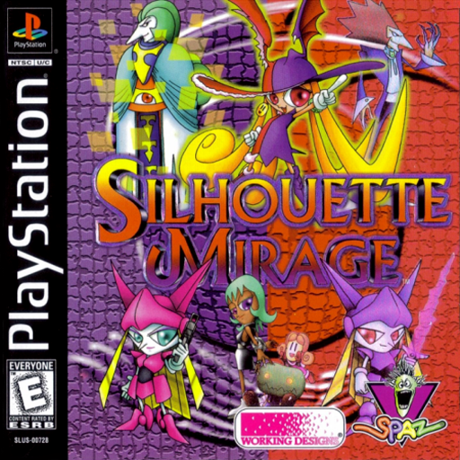

# Silhouette Mirage

<!-- retcomm-readme-metrics -->
[](https://github.com/RetroPortingToolKit/silhouette-mirage-recomp/releases)
[](https://github.com/RetroPortingToolKit/silhouette-mirage-recomp/releases/latest)
[](https://github.com/RetroPortingToolKit/silhouette-mirage-recomp/releases/latest)
<!-- /retcomm-readme-metrics -->

<!-- retcomm-readme-boxart -->
<p align="center">
  
</p>
<!-- /retcomm-readme-boxart -->

Static recompilation of **Silhouette Mirage** built on
[psxrecomp](https://github.com/mstan/psxrecomp) and
[recomp-ui](https://github.com/RetroPortingToolKit/recomp-ui).

A 2D action platformer where players control Shyna and navigate a world divided between the forces of Light and Dark.

| | |
|---|---|
| Players | 1 |
| Region | USA |
| Publisher | Working Designs |
| Year | 1997 |

# Silhouette Mirage

A static recompilation of **Silhouette Mirage** for Windows, built with [PSXRecomp](https://github.com/mstan/psxrecomp).

Silhouette Mirage is a 2D action platformer starring Shyna, set in a world divided between the forces of Light and Dark.

## Project Status

**Playable — testing in progress.**

- Successfully built and launched on Windows.
- Gameplay tested through Level 2.
- Levels beyond Level 2 have not yet been verified.
- Infinite Credits cheat tested and confirmed working.

## Cheat Support

Includes an optional built-in cheat package with toggles available in the mod menu.

| Cheat | Description |
|---|---|
| Infinite Credits | Restores credits to 9 after each level transition. |
| All Options | Unlocks all options. |
| Secret Mode | Enables all options and Secret Mode. |

All cheats are optional and disabled by default.

### Infinite Credits behaviour

Credits may decrease during gameplay. When the next loading screen completes during a level transition, credits are restored to 9.

This behaviour has been tested and confirmed.

## Requirements

- A legally obtained copy of the original Silhouette Mirage (USA).

The project uses the bundled MIT-licensed OpenBIOS. No retail PlayStation BIOS is required.

Game disc images are not included. You must provide your own legally obtained copy of the game.

## Building

This project uses [PSXRecomp](https://github.com/mstan/psxrecomp).

Clone the repository with its submodules:

```bash
git clone --recurse-submodules https://github.com/ijezabella/silhouette-mirage-recomp.git
cd silhouette-mirage-recomp
```

On Windows, configure your game disc in the project configuration, then run:

```powershell
python .\psxrecomp\psxrecomp_cli.py rebuild --config game.toml --project-root . --build-dir build-release --no-pgo
```

The build process generates the Windows executable in the build directory.

## Credits

- **Working Designs** — Original game's publisher.
- **PSXRecomp** — PlayStation static recompilation framework.
- **OpenBIOS** — MIT-licensed BIOS implementation.

Silhouette Mirage is © its respective rights holders.

This is an unofficial fan project and is not affiliated with or endorsed by the original rights holders.